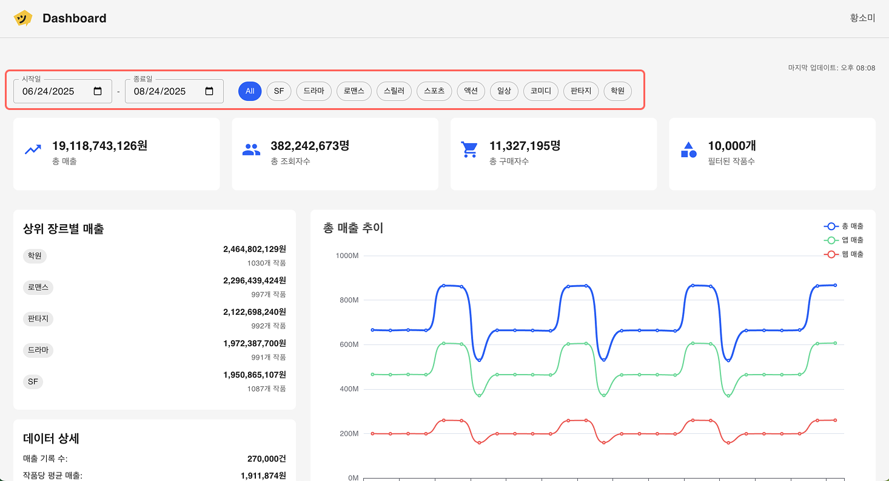
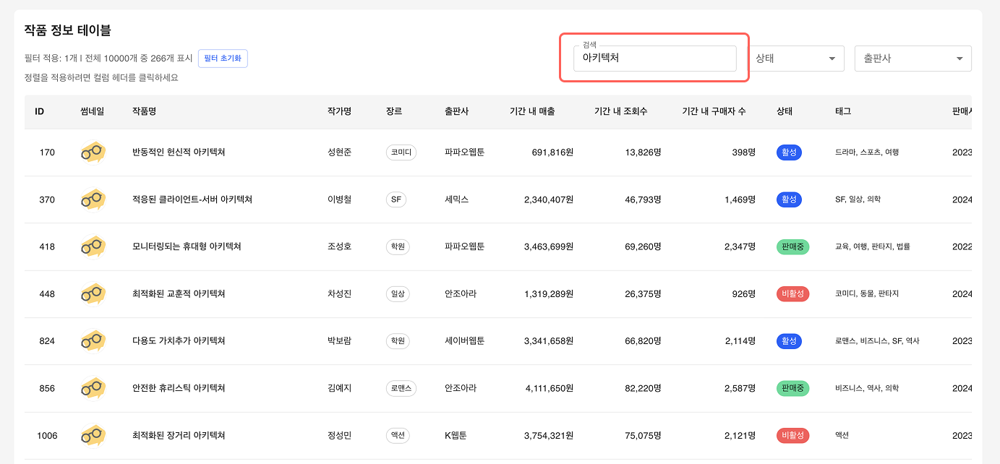

# Kakao Piccoma Dashboard

웹툰 작품의 기간별 매출 데이터를 시각화 한 단일 페이지 대시보드 애플리케이션입니다.

## 🚀 프로젝트 실행 방법

### 환경 요구사항

- Node.js 20.x 이상
- npm

### 설치 및 실행

```bash
# 의존성 설치
npm install

# 개발 서버 실행
npm run dev
```

## 🛠 사용 기술 스택

### Frontend

- **React 19** – 최신 React 기반 SPA
- **TypeScript** – 타입 안정성과 유지보수성 강화
- **Vite** – 빠른 번들링과 HMR

### 상태 관리 & 데이터 처리

- **Zustand** – 경량 전역 상태 관리
- **TanStack Query** – 서버 상태 관리 및 캐싱
- **TanStack Table** – 대규모 데이터 테이블 처리
- **Web Workers** – 대용량 데이터 병렬 처리 및 성능 최적화

### UI/UX

- **Material-UI (MUI)** – 디자인 시스템 기반 UI
- **ECharts** – 차트 시각화 라이브러리

### 검색 & 필터링

- **Fuse.js** – 퍼지 검색(Fuzzy Search)
- **use-debounce** – 검색 입력 최적화

### 개발 생산성

- **ESLint + Prettier + TypeScript ESLint** – 코드 품질 유지

## 📁 폴더 구조

```
src/
├── app/                   # 앱 초기 설정 및 Providers
│   ├── App.tsx
│   └── providers/
├── entities/              # 도메인 엔티티 (비즈니스 로직)
│   ├── product/           # 작품 메타데이터
│   ├── sales/             # 매출 데이터
│   └── joined/            # productId 기준 데이터 조인
├── features/              # 독립적 기능 모듈
│   └── filter/            # 전역 필터링 기능
│       ├── hooks/
│       ├── model/
│       └── ui/
├── pages/
│   └── DashboardPage/    # 메인 대시보드 페이지
├── shared/               # 공통 유틸리티/컴포넌트
│   ├── api/              # fetchers, query-keys
│   └── ui/               # 재사용 UI 컴포넌트
└── widgets/              # 위젯 단위 UI
    ├── Header/
    ├── FilterSection/
    ├── TotalSummary/
    ├── DetailedSummary/
    ├── LineChartSection/
    ├── PieChartSection/
    ├── StackedBarChartSection/
    ├── ProductTable/
    └── DataRefreshWidget/
```

**아키텍처 특징**

- Feature-Sliced Design(FSD) + 도메인 단위 구조화
- Adapter & Repository 패턴으로 API → 도메인 모델 변환

## ⭐ 주요 기능

### 📊 데이터 시각화

- **총 매출 요약 패널**: 기간별 매출/조회수/구매자수/작품수
- **라인 차트**: 시간에 따른 전체 매출 추이
- **스택 바 차트**: 장르/작품/출판사별 매출 비교
- **파이 차트**: 장르별 매출/작품수 분포 및 필터링 동기화

### 🔍 필터링 & 검색

- 장르, 기간별 **다중 필터링**
  

- **파이 차트 ↔ 필터 상태 양방향 동기화**: 파이 차트 클릭 시 타 차트/테이블에 필터링 적용
  

- **Fuse.js 기반 퍼지 검색**: 작품명/작가명/출판사로 빠른 검색
  

- **URL 쿼리 동기화**: 필터 적용 후 새로고침/공유 시 동일 상태 유지
  

### 📋 데이터 테이블

- 작품 메타데이터 + 기간별 매출/조회수/구매자수 표시
- **페이지네이션 지원**
- **멀티 컬럼 정렬** (최대 5개)
  
- **테이블 전용 로컬 필터** (상태/출판사/검색어)
  

### ⚡ 성능 최적화

- **Web Worker + Transferable Object** 활용으로 대용량 데이터 처리 성능 개선
- **Map 기반 인덱싱 시스템** 도입으로 ProductId/장르/날짜별 빠른 필터링
- **Fuse.js 검색 인덱스** 활용으로 작품명/작가명/출판사 퍼지 검색 최적화
- **React.memo / useMemo / useCallback** 적극 활용
- **`Last-Modified` 기반 신선도 체크**로 데이터 업데이트 감지

### 🎨 UX/UI

- 파이 차트 클릭 시 필터와 연동되는 직관적 상호작용
- 반응형 레이아웃 (Mobile/Tablet/Desktop)
- Skeleton UI (로딩 중 피드백)
  
- 시멘틱 태그와 ARIA Label을 기반으로 한 접근성 개선
